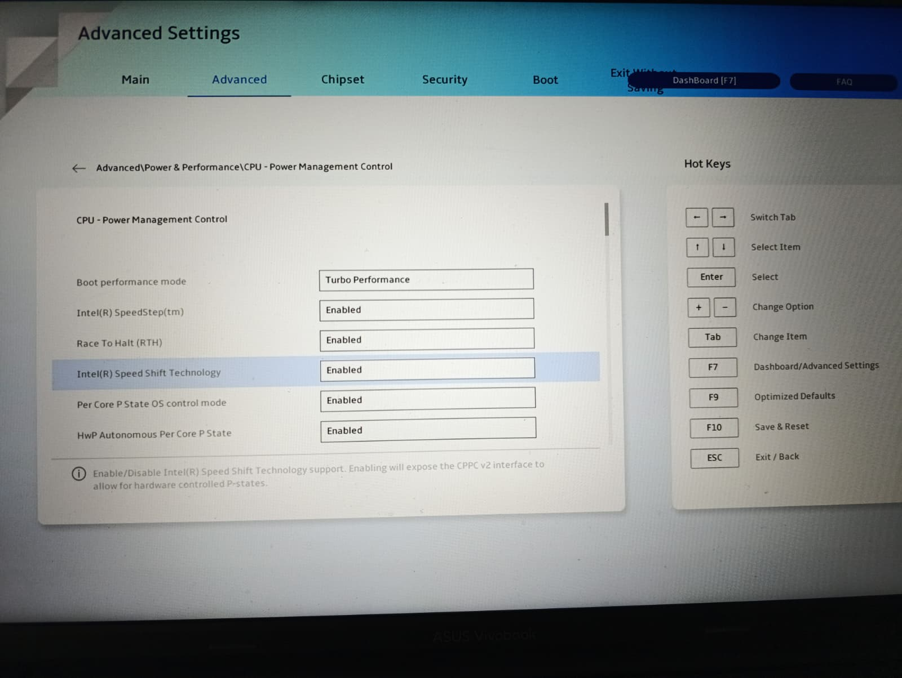

# UEFI-RESEARCH-AI

## Disclaimer

**EXPERIMENTAL. PROGRAMMED WITH AI ASSISTANCE. DANGEROUS.** This repository documents highly experimental UEFI reverse engineering on one ASUS K3605ZC laptop running BIOS 317. The code, tests, and explanations were largely generated by AI. Running these binaries may corrupt the BIOS, cause data loss, or even render the device unusable. I am not responsible for any damage. Many addresses, form IDs, assumptions, and fingerprints are specific to the tested BIOS revision. Their apparent success on one device does **not** establish safety on another revision or machine. A boot that "worked" is not proof against latent failures.

No support, safety, or compatibility warranty is offered. Nothing here is an instruction to flash modified BIOS images or to disable platform security safeguards. Use at your own risk.

## AI Disclosure

The UEFI experiments, scripts, test harnesses, reports, and portions of the documentation in this repository were generated by AI during an interactive exploration with human hardware testing and feedback. Code review was partial and generally focused on immediate experimental goals. There has been no independent professional security audit.

**However, I rewrote it by hand!** The current `src/ram17.c` is written by hand and is capable of unlocking the hidden options on my ASUS K3605ZC with BIOS version 317. In this process, I not only drastically reduced the size of the source file but also learned a lot about EFI programming, and I tried to make it as clear and understandable as possible to serve as a future learning resource.

## Publication Note

The motivation for publication is to present the source as a reference for EFI programming and BIOS engineering. The project is purely educational and curiosity-driven. Please do not try it on your device unless you understand what you are doing. You have been warned.

## Research Motivation

The original motivation was an Intel AX210 Wi-Fi suspend failure associated with PCI D3cold. While investigating the firmware, I decided to focus on the BIOS to investigate the failure, but could not find anything. Therefore, I decided to use AI to investigate the BIOS to find extra options that could help. AI decoded the vendor's AMI/ASUS HII setup structures and located the executing AMITSE / `EFI_FORM_BROWSER2_PROTOCOL` driver (distinct from an inert memory copy). Its in-memory menu exclusion records were shown to control visibility of the native ASUS graphical menu, and a list of excluded menu items was found.

## Research Outcome

**Confirmed on the physical laptop:** The utility cleared a generic Advanced page exclusion flag and set a one-shot browser mode byte. After returning from EFI Shell, a second Advanced tab appeared in ASUS Setup, and submenus were accessible. Rebooting restored the original restricted UI. **No BIOS flashing was required to expose the additional tab.** However, grouping six hidden categories under one "Hidden Configuration" submenu remains unsolved.

## Future Goals

- Isolate the minimum visibility change: page exclusion flag alone versus combined flag and one-shot mode.
- Explain why generic root `0x2710` exists in IFR but lacks a validated runtime page record.
- Characterize HII package ownership / notifications using safe mocks or emulation.
- Build a read-only generic IFR inspector with proper user-supplied firmware parsing and no committed OEM extracts.
- Add repeatable QEMU/OVMF hardware-independent tests where applicable; the ASUS proprietary graphical browser is not emulated by stock OVMF.

## Tested Configurations

| Hardware                  | Firmware         | Target      |
| ------------------------- | ---------------- | ----------- |
| ASUS Vivobook 16X K3605ZC | K3605ZC BIOS 317 | UEFI x86-64 |

## Development

To compile the tool, use the following steps:

1. `cd src`
2. `git clone https://github.com/ncroxon/gnu-efi.git`
3. `make FILENAME=ram17`

To run in an emulator:

1. `cd src`
2. `mkdir ovmf-disk`
3. `cp *.efi ovmf-disk/`
4. `make FILENAME=1 emu`
5. Inside the EFI Shell, run `fs0:` and then your `*.efi` file.
6. Keep in mind that `ram17.efi` does not work in the emulator.

To run on the ASUS K3605ZC:

1. Prepare an EFI Shell USB.
2. Put `ram17.efi` in its root directory.
3. BIOS > Advanced Options > Save & Exit > EFI Shell
4. Run `fs0:`, then `ram17.efi`, and finally `exit`.

## License Note

The ASUS/AMI firmware and any extracted proprietary binary/string resources are not licensed by this repository. Their absence is intentional. Experiments may contain names, constants, and interfaces derived from firmware analysis.

## References

- https://wiki.osdev.org/GNU-EFI
- https://www.rodsbooks.com/efi-programming/index.html

## License

MIT
